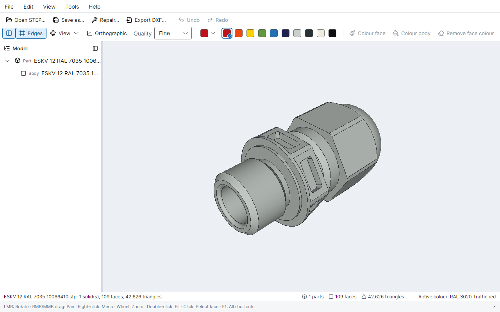
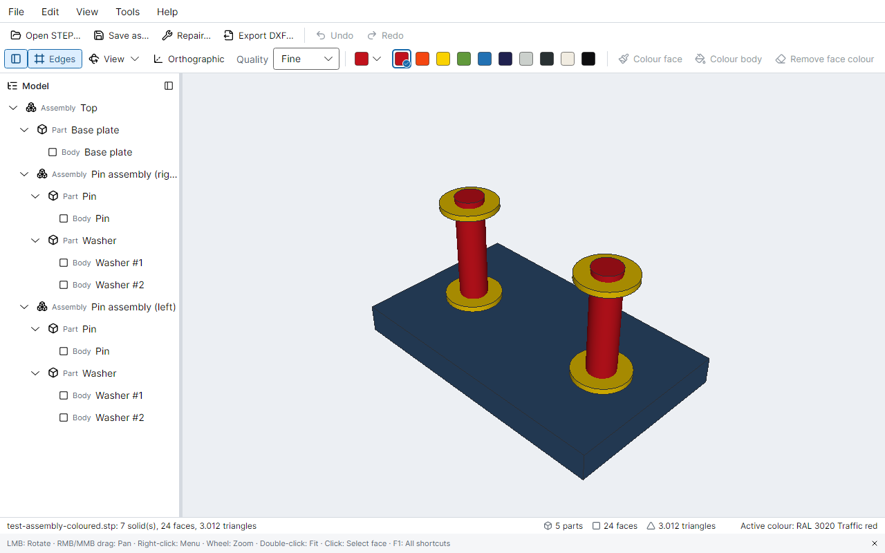

#  UpSTEPer

**View, colour, repair and convert STEP models — cross-platform, open source, built on Open CASCADE.**

[](https://github.com/mattheuserb/UpSTEPer/actions/workflows/ci.yml)
[](LICENSE)



UpSTEPer is a desktop app and a command-line tool for the everyday chores around STEP files:
look at a model, give bodies and faces the right colours, fix what a poor exporter left behind and
hand 2D views to someone who works with DXF. It reads and writes STEP with
[Open CASCADE Technology](https://dev.opencascade.org/) and needs no CAD licence.

> **Status: alpha.** Used and tested on Windows; Linux and macOS are covered by CI. There are no
> binary releases yet; build from source (below). See the [roadmap](docs/roadmap.md).

## Features

| | App | CLI |
|---|---|---|
| **View** STEP (AP203, AP214, AP242): orbit, pan, zoom, standard views, orthographic, edges, model tree of assemblies, parts and bodies, display quality | ✅ | `info --tree` |
| **Colour** faces and bodies (also single instances in assemblies), RAL Classic list and favourites, undo/redo, save as STEP AP214 or AP242 | ✅ | `paint` |
| **Check** per part: gaps, invalid shapes, spline faces and edges that are really planes, cylinders, circles…, faces that can be merged | ✅ | `check` |
| **Repair**: heal and sew, merge faces, turn such splines into exact surfaces and curves; colours are kept, a report lists every change | ✅ | `repair` |
| **Export DXF**: 2D views (front, top, left, optional isometric) with exact hidden-line removal; circles and arcs stay circles and arcs, scale 1:1 in mm | ✅ | `export-dxf` |

The app speaks English and German (View → Language).



## Command line

```bash
upsteper info model.stp --tree                       # statistics, colours, model tree with body ids
upsteper paint in.stp out.stp --body 0=#3366CC --face 80=#FF0000 --schema ap242
upsteper check model.stp                             # exit code 3 when defects are found
upsteper repair in.stp out.stp --steps fix,sew,canonical,merge
upsteper export-dxf model.stp drawing.dxf --views front,top,left,iso
```

From a source checkout, run these as `dotnet run --project src/UpSTEPer.Cli -- <command> ...`.

## Platforms

| | Windows x64 | Linux x64 | macOS arm64 |
|---|---|---|---|
| CLI | ✅ | ✅ | ✅ |
| App | ✅ | ✅ (CI: rendering smoke test) | 3D view not working yet ([details](docs/roadmap.md#macos-support-last)) |

## Known limitations

- Faceted models (circles made of many flat faces) cannot be turned back into true cylinders yet
  ([M5](docs/roadmap.md#m5--repair-tier-3-faceted--analytic)).
- Face ids change after a repair; colours are carried over, ids are not
  ([ADR 0005](docs/adr/0005-topology-identity.md)).
- DXF only (no DWG), no dimensions, frames or title blocks.

## Build from source

You need the .NET 10 SDK, and for the geometry kernel a C++17 compiler, CMake ≥ 3.24, Ninja and
[vcpkg](https://vcpkg.io/). The first native build compiles Open CASCADE and takes about an hour.
Step by step for every platform: [docs/development.md](docs/development.md).

```bash
# 1. Native bridge (Windows; the script sets up the MSVC environment)
powershell -File scripts/build-native.ps1 -VcpkgRoot C:\vcpkg
#    Linux/macOS: cd native && cmake --preset linux-x64 && cmake --build --preset linux-x64 && cmake --install build/linux-x64

# 2. Build, test, run
dotnet build
dotnet test
dotnet run --project src/UpSTEPer.App -- "examples/ESKV 12 RAL 7035 10066410.stp"
```

Without step 1 everything still builds; tests that need the geometry kernel are skipped.

## Architecture in one picture

```
 UpSTEPer.App (Avalonia)    UpSTEPer.Cli (System.CommandLine)
         │      \                /
         │       └─ UpSTEPer.Core ┘          domain model + abstractions, no native deps
 UpSTEPer.Rendering      ▲
 (OpenGL, Silk.NET)  UpSTEPer.Occt           implements Core via P/Invoke + SafeHandles
                         │  C ABI (upsteper.h)
                 native/ upsteper_native     thin C++ facade, CMake + vcpkg
                         │
                 Open CASCADE Technology 8   (LGPL-2.1, dynamically linked)
```

Details: [docs/architecture.md](docs/architecture.md) · Decisions: [docs/adr/](docs/adr/)

## Documentation

| Document | For |
|---|---|
| [docs/development.md](docs/development.md) | Setting up a machine, building, testing, debugging |
| [docs/architecture.md](docs/architecture.md) | Layers, threading, memory ownership, extension points |
| [docs/roadmap.md](docs/roadmap.md) | Milestones and open work |
| [docs/adr/](docs/adr/) | Why things are the way they are |
| [docs/test-data.md](docs/test-data.md) | Test files and what they cover |
| [docs/packaging.md](docs/packaging.md) | Distribution folder, Windows installer, Linux Flatpak |
| [docs/releasing.md](docs/releasing.md) | How a release is made |
| [CLAUDE.md](CLAUDE.md) | Working on this repo with Claude Code (also a good human cheat-sheet) |
| [CONTRIBUTING.md](CONTRIBUTING.md) | Workflow, conventions, PR checklist |

## Contributing

Bug reports, test files that break UpSTEPer and pull requests are welcome; please read
[CONTRIBUTING.md](CONTRIBUTING.md) first. Before pushing, run the same quality gate as CI:
`./scripts/check.ps1`.

## License

UpSTEPer is MIT licensed. It dynamically links Open CASCADE Technology (LGPL-2.1 with
exception) and other third-party components; see [THIRD-PARTY-NOTICES.md](THIRD-PARTY-NOTICES.md).

The cable gland in the first screenshot and in `examples/` is a manufacturer model by CADENAS,
CC BY-ND 4.0, shown unmodified. Screenshots are regenerated with `scripts/update-screenshots.ps1`.
